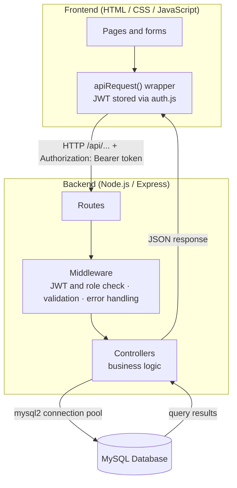
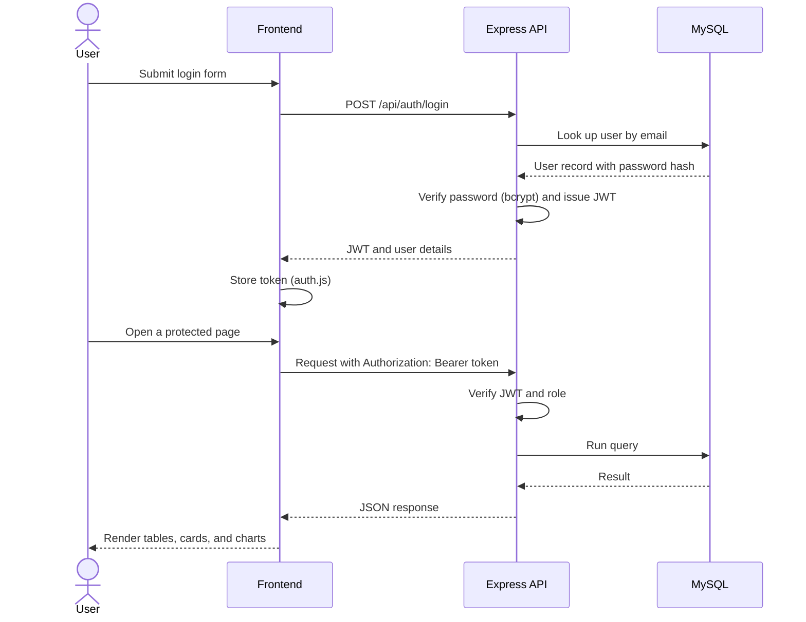
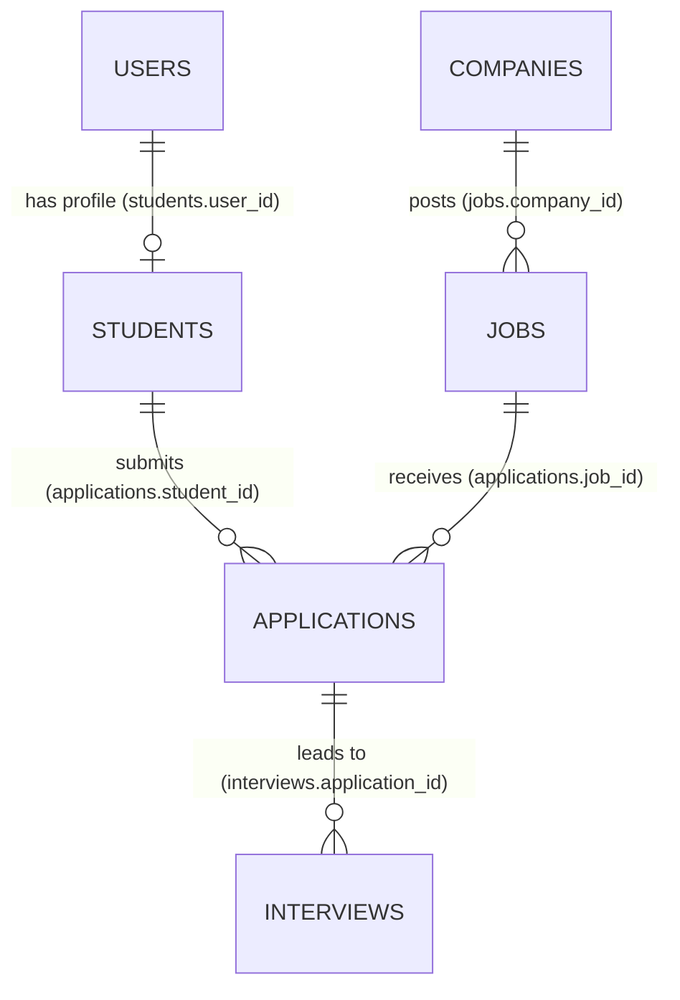

<div align="center">

# 🎓 Placement Management System

**A full-stack web application for managing college placements: students, companies, job postings, applications, interviews, and placement analytics.**


</div>

---

## Table of Contents

- [Overview](#overview)
- [Key Features](#key-features)
- [User Roles](#user-roles)
- [Technology Stack](#technology-stack)
- [System Architecture](#system-architecture)
- [Project Structure](#project-structure)
- [Getting Started](#getting-started)
- [Demo Accounts](#demo-accounts)
- [Application Walkthrough](#application-walkthrough)
- [Backend and Database](#backend-and-database)
- [API Reference](#api-reference)
- [Admin Analytics Dashboard](#admin-analytics-dashboard)
- [Screenshots](#screenshots)
- [Manual Testing Checklist](#manual-testing-checklist)
- [Troubleshooting](#troubleshooting)
- [Security Notes](#security-notes)
- [Future Enhancements](#future-enhancements)

---

## Overview

The **Placement Management System** brings the activities of a college placement cell into a single application. Administrators manage students, companies, job postings, applications, and interviews, and track outcomes through an analytics dashboard. Students log in to view their profile, browse jobs, apply, and follow their applications and interviews.

The application is built with a plain **HTML, CSS, and JavaScript** frontend, a **Node.js / Express** REST API, and a **MySQL** database. Routes are protected with **JWT** authentication, passwords are hashed with **bcrypt**, and placement data is visualized with **Chart.js**.

## Key Features

### 🔐 Authentication and Access Control
- Separate admin and student login
- JWT-protected REST API routes
- Password hashing with bcrypt
- Role-based authorization for admin-only and student-facing operations

### 📋 Placement Management
- Student and company record management
- Job posting and browsing
- Application submission and tracking
- Interview scheduling and updates
- Application statuses: shortlisted, selected, and rejected

### 📊 Admin Dashboard and Analytics
- KPI cards for students, companies, jobs, applications, selections, rejections, and upcoming interviews
- Placement percentage, highest package, and average package
- Chart.js visualizations: students by department, placement status, company-wise hiring, applications over time, package distribution, and interview timeline
- Recent applications, upcoming interviews, and top offers

### 🎨 User Interface
- Responsive layout with dashboard cards, tables, forms, and alerts
- Light and dark themes with a navbar toggle; the choice is saved in `localStorage`
- Loading animation and animated analytics panels
- Charts restyle automatically when the theme changes

### 🗄️ Database
- Relational MySQL schema with primary and foreign keys
- `database.sql` seeds sample data: 19 students, 7 companies, 12 jobs, 25 applications, plus interview, selection, rejection, and package-statistics records

## User Roles

| Capability | Admin | Student |
|---|:---:|:---:|
| Log in with role-based access | ✅ | ✅ |
| Register a student account | — | ✅ |
| Manage students | ✅ | — |
| Manage companies and jobs | ✅ | — |
| View companies and jobs | ✅ | ✅ |
| Submit applications | ✅ | ✅ |
| View all applications / update status | ✅ | — |
| View own applications and interviews | — | ✅ |
| Schedule and manage interviews | ✅ | — |
| View analytics dashboard | ✅ | — |

## Technology Stack

| Layer | Technologies |
|---|---|
| Frontend | HTML, CSS, JavaScript |
| Backend | Node.js, Express.js |
| Database | MySQL (`mysql2/promise` driver) |
| Authentication | JSON Web Tokens (JWT), bcrypt |
| API communication | REST endpoints, Fetch API |
| Data visualization | Chart.js |

## System Architecture

The application follows a three-tier structure: a browser frontend, an Express REST API, and a MySQL database.



### Authentication flow



## Project Structure

```text
placement-management-system/
├── backend/
│   ├── server.js
│   └── src/
│       ├── config/
│       │   └── db.js
│       ├── controllers/
│       ├── middleware/
│       ├── routes/
│       └── utils/
├── frontend/
│   ├── index.html
│   ├── admin-dashboard.html
│   ├── student-dashboard.html
│   ├── students.html
│   ├── companies.html
│   ├── jobs.html
│   ├── applications.html
│   ├── interviews.html
│   └── assets/
│       ├── css/
│       └── js/
├── screenshots/
├── database.sql
├── .env.example
├── package.json
└── README.md
```

## Getting Started

### Prerequisites

- [Node.js](https://nodejs.org/)
- MySQL Server
- MySQL Workbench or the MySQL command-line client

### 1. Clone the repository

```bash
git clone <your-repository-url>
cd placement-management-system
```

### 2. Install dependencies

```bash
npm install
```

### 3. Configure environment variables

Create a local `.env` file from the example.

**Windows**
```powershell
copy .env.example .env
```

**macOS / Linux**
```bash
cp .env.example .env
```

Then edit `.env` with your local MySQL details and a JWT secret:

```env
DB_HOST=localhost
DB_USER=root
DB_PASSWORD=your_mysql_password
DB_NAME=placement_management
JWT_SECRET=replace_this_with_a_long_random_secret
```

> Never commit your real `.env` file to version control.

### 4. Create and seed the database

With the MySQL server running, import the schema and sample data from the project root:

```bash
mysql -u root -p < database.sql
```

### 5. Start the application

```bash
npm start
```

### 6. Open the app

Visit **http://localhost:5000**. If you set a different `PORT` in `.env`, use that port instead.

## Demo Accounts

The seed data includes these accounts for local demonstration:

| Role | Email | Password |
|---|---|---|
| Admin | `admin@college.edu` | `password123` |
| Student | `aarav@student.edu` | `password123` |

These credentials are for the sample database only. Change or remove them before any public deployment.

## Application Walkthrough

### Frontend pages

| Page | Purpose |
|---|---|
| `index.html` | Login |
| `admin-dashboard.html` | KPIs, analytics, recent applications, upcoming interviews, top offers |
| `student-dashboard.html` | Student profile and available jobs |
| `students.html` | Student management |
| `companies.html` | Company management |
| `jobs.html` | Job management |
| `applications.html` | Application tracking |
| `interviews.html` | Interview management |

### Request flow

1. A user submits a form or interacts with a page.
2. The page script builds a JSON payload.
3. `frontend/assets/js/api.js` sends it through `apiRequest()` to the relevant `/api/...` endpoint, attaching the JWT as `Authorization: Bearer <token>` for authenticated requests.
4. The backend validates the request and the caller's permissions, runs the database operation, and returns JSON.
5. The frontend updates the relevant tables, cards, charts, alerts, or forms.

Shared scripts: `auth.js` handles JWT storage and protected-page checks, and `ui.js` manages the persistent light/dark theme.

## Backend and Database

### Backend organization

| Path | Responsibility |
|---|---|
| `backend/server.js` | Initializes Express, configures middleware, serves the frontend, registers API routes |
| `backend/src/config/db.js` | Creates the MySQL connection pool |
| `backend/src/routes/` | API route mappings |
| `backend/src/controllers/` | Business logic for each module |
| `backend/src/middleware/authMiddleware.js` | Verifies JWTs and role permissions |
| `backend/src/middleware/validate.js` | Validates incoming data |
| `backend/src/middleware/errorMiddleware.js` | Returns consistent JSON error responses |

### Entity relationships



- `users` stores login identities for admins and students.
- Foreign keys use cascade deletion where configured in the schema.

## API Reference

All endpoints use JSON request and response bodies. Protected endpoints require a valid JWT in the `Authorization` header.

**Example: log in and call a protected endpoint**

```bash
curl -X POST http://localhost:5000/api/auth/login \
  -H "Content-Type: application/json" \
  -d '{"email": "admin@college.edu", "password": "password123"}'

curl http://localhost:5000/api/students \
  -H "Authorization: Bearer <token>"
```

### Authentication

| Method | Endpoint | Access | Description |
|---|---|---|---|
| `POST` | `/api/auth/login` | Public | Log in as admin or student |
| `POST` | `/api/auth/register-student` | Public | Register a student account |

### Students

| Method | Endpoint | Access | Description |
|---|---|---|---|
| `GET` | `/api/students` | Admin | List students |
| `GET` | `/api/students/:id` | Admin | Get one student |
| `POST` | `/api/students` | Admin | Create a student |
| `PUT` | `/api/students/:id` | Admin | Update a student |
| `DELETE` | `/api/students/:id` | Admin | Delete a student |
| `GET` | `/api/students/me` | Student | View own profile |

### Companies

| Method | Endpoint | Access | Description |
|---|---|---|---|
| `GET` | `/api/companies` | Admin / Student | List companies |
| `GET` | `/api/companies/:id` | Admin / Student | Get one company |
| `POST` | `/api/companies` | Admin | Create a company |
| `PUT` | `/api/companies/:id` | Admin | Update a company |
| `DELETE` | `/api/companies/:id` | Admin | Delete a company |

### Jobs

| Method | Endpoint | Access | Description |
|---|---|---|---|
| `GET` | `/api/jobs` | Admin / Student | List jobs |
| `GET` | `/api/jobs/:id` | Admin / Student | Get one job |
| `POST` | `/api/jobs` | Admin | Create a job |
| `PUT` | `/api/jobs/:id` | Admin | Update a job |
| `DELETE` | `/api/jobs/:id` | Admin | Delete a job |

### Applications

| Method | Endpoint | Access | Description |
|---|---|---|---|
| `GET` | `/api/applications` | Admin | List all applications |
| `GET` | `/api/applications/me` | Student | List own applications |
| `POST` | `/api/applications` | Admin / Student | Submit an application |
| `PATCH` | `/api/applications/:id/status` | Admin | Update status (shortlisted, selected, rejected) |
| `DELETE` | `/api/applications/:id` | Admin | Delete an application |

### Interviews

| Method | Endpoint | Access | Description |
|---|---|---|---|
| `GET` | `/api/interviews` | Admin | List interviews |
| `GET` | `/api/interviews/me` | Student | List own interviews |
| `POST` | `/api/interviews` | Admin | Schedule an interview |
| `PUT` | `/api/interviews/:id` | Admin | Update an interview |
| `DELETE` | `/api/interviews/:id` | Admin | Delete an interview |

### Dashboard and health

| Method | Endpoint | Access | Description |
|---|---|---|---|
| `GET` | `/api/dashboard/stats` | Admin | Dashboard KPIs and summary data |
| `GET` | `/api/dashboard/analytics` | Admin | Chart datasets for dashboard analytics |
| `GET` | `/api/health` | Public | API health check |

## Admin Analytics Dashboard

The dashboard summarizes placement activity through KPI cards and charts rendered with Chart.js. Charts remain readable in both light and dark themes.

| KPI cards | Charts |
|---|---|
| Total students, companies, jobs, applications | Students per department |
| Selected and rejected students | Placement status |
| Upcoming interviews | Company-wise hiring |
| Placement percentage | Applications over time |
| Highest and average package | Package distribution · Interview timeline |

## Screenshots

### Login


### Admin Dashboard

| Light theme | Dark theme |
|---|---|
|  |  |

### Student Dashboard


### Jobs


## Manual Testing Checklist

- [ ] Start the MySQL server and import `database.sql`.
- [ ] Configure `.env`, run `npm install`, and start the app with `npm start`.
- [ ] Open `http://localhost:5000`.
- [ ] Log in as admin and test student, company, job, application, and interview management.
- [ ] Log in as a student and test the job browsing and application flows.
- [ ] Check interview information from the student view.
- [ ] Toggle the theme, refresh, and confirm the preference persists.
- [ ] Confirm the admin dashboard charts render in both themes.

## Troubleshooting

| Problem | What to check |
|---|---|
| Login fails | Confirm the seed data was imported and you are using the demo email and password. |
| MySQL connection fails | Make sure MySQL is running and `DB_HOST`, `DB_USER`, `DB_PASSWORD`, and `DB_NAME` match your setup. |
| Database or table not found | Confirm `database.sql` was imported into the database named in `.env`. |
| Port `5000` is busy | Set a different `PORT` in `.env` and restart the server. |
| Charts do not appear | Check the browser console for errors and confirm the Chart.js CDN can load. |

## Security Notes

- Keep `.env` and all real credentials out of version control.
- Use a strong, unique `JWT_SECRET`.
- The demo credentials are for local use only; do not ship them to production.
- Before deploying publicly, review authentication, authorization, input validation, and database configuration.

## Future Enhancements

- Email notifications for application and interview updates
- Resume upload and parsing
- Advanced search and filtering
- Production deployment with environment-specific configuration
- Automated unit and API tests
